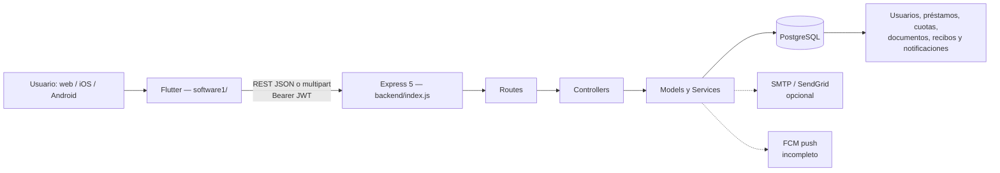

# AppPrestamos — contexto arquitectónico histórico

> Última actualización: 2026-08-21
>
> Alcance: arquitectura, estructura, flujos, contratos, entorno local, estado Git, riesgos y trabajo pendiente.
>
> Seguridad: este documento no contiene contraseñas, JWT, claves, valores reales de `.env`, datos personales ni rutas al backup.

> Aviso añadido el 2026-09-19: este documento conserva el análisis histórico, no es la fuente actual de permisos,
> tareas activas, resultados de pruebas ni comandos RUN. Lee primero [AGENTS.md](../AGENTS.md),
> [CURRENT_STATE.md](CURRENT_STATE.md) y la guía correspondiente: [WORKFLOW.md](WORKFLOW.md) o
> [RUNTIME_RUNBOOK.md](RUNTIME_RUNBOOK.md). El código ha cambiado desde este análisis; por ejemplo, la creación de
> solicitudes ya consulta términos de loan_options. Los lotes y prompts antiguos de abajo no autorizan ejecución.

## 0. Cómo usar este documento

Usa este archivo solo como referencia arquitectónica por secciones. No es necesario cargarlo completo para cada tarea.

Antes de actuar:

1. Lee `AGENTS.md` y `docs/CURRENT_STATE.md`, y después verifica el área relevante contra el código actual.
2. Para ejecutar la aplicación, sigue `docs/RUNTIME_RUNBOOK.md`; `LOCAL_DEVELOPMENT.md` es histórico.
3. Ejecuta `git status --short` y confirma que entiendes el árbol sucio.
4. Verifica los procesos y servicios actuales; no asumas que PostgreSQL, backend o Flutter siguen activos.
5. Reutiliza la base local y las cuentas existentes según `docs/WORKFLOW.md`; no crees bases/cuentas ni modifiques datos anteriores sin permiso.
6. No leas, muestres, copies ni versionees `backend/.env`, dumps, JWT, credenciales o filas con datos personales.
7. No ejecutes `git reset`, `git clean`, `git add -A`, commit, push, restauraciones, migraciones, correo real o despliegues sin que la tarea lo autorice.

Para saber qué está implementado, verifica código y diffs actuales. Eso no convierte un bug en requisito ni autoriza cambios.
Las decisiones actuales del usuario y AGENTS/WORKFLOW/RUNTIME prevalecen sobre instrucciones, permisos y prompts históricos de abajo.

## 1. Resumen ejecutivo

AppPrestamos es una aplicación de préstamos personales orientada a República Dominicana. La interfaz está construida en Flutter para web, iOS, Android y shells de escritorio. El backend es una API REST en Node.js/Express con PostgreSQL.

El proyecto estuvo pausado. El backend y la base de datos alojados anteriormente en Render fueron suspendidos. La estrategia actual es desarrollar y probar contra una copia local aislada de PostgreSQL, usar Flutter Web para iteración rápida y validar después el comportamiento nativo en simulador/iPhone.

Estado general:

- La navegación, autenticación, paneles cliente/admin y lecturas principales funcionan localmente.
- El frontend ya no contiene URLs literales de Render; usa `API_BASE_URL` por build.
- Existe un dump completo externo al repositorio y un script de restauración segura.
- Hay cambios locales importantes todavía sin commit ni publicación.
- El sistema aún no está listo para operar con dinero real ni distribuirse en tiendas.
- Los P0 iniciales de Android, recibos/SMTP y notifier documental están corregidos localmente; los riesgos prioritarios restantes están en reglas financieras, transacciones, seguridad de tokens, migraciones, distribución y cobertura E2E.

## 2. Identidad del repositorio y snapshot Git

| Campo | Valor al 2026-08-20 |
|---|---|
| Raíz real | `/Users/johancarlosherrera/Documents/ChatGPT/Proyecto_AppPrestamos/AppPrestamos` |
| Carpeta exterior | `Proyecto_AppPrestamos/`; no es el repositorio Git |
| Remoto | `https://github.com/jkilleran/AppPrestamos.git` |
| Rama de trabajo | `codex/resume-local-dev` |
| Upstream de la rama | No configurado |
| HEAD | `5b2edaf7f96f8e85b86e3c4a62a6d65e7902afd2` (`commit 1-6`) |
| Rama local `main` | Mismo commit |
| GitHub `main` | Confirmado mediante `git ls-remote` en el mismo commit el 2026-08-20 |
| Commits locales exclusivos | Ninguno |
| Trabajo no publicado | Sí; numerosos cambios staged, unstaged y untracked |

El historial comprometido coincide con GitHub, pero la reanudación del proyecto vive todavía en el working tree local.

Resumen del árbol sucio antes de crear este documento:

- 1,123 eliminaciones staged:
  - 1,115 archivos `node_modules` anteriormente versionados;
  - residuos de BFG, `.DS_Store`, `replace-text.txt`, un PDF de recibo y un archivo accidental.
- 45 archivos de código/configuración modificados o eliminados sin stage, aproximadamente `+3706/-1886`.
- 8 archivos nuevos sin seguimiento:
  - `backend/test/security-critical.test.js`
  - `backend/utils/authConfig.js`
  - `docs/LOCAL_DEVELOPMENT.md`
  - `scripts/restore_local_db.sh`
  - `software1/ios/Podfile.lock`
  - `software1/lib/config/api_config.dart`
  - `software1/lib/utils/auth_session.dart`
  - `software1/test/auth_session_test.dart`
- Este archivo añade otro archivo nuevo: `docs/PROJECT_CONTEXT.md`.

Regla crítica: no compactar todo esto en un solo commit sin revisión. Los grupos naturales son limpieza del repositorio, backend/seguridad, Flutter/UI, plataformas y documentación.

## 3. Arquitectura de alto nivel



Principios actuales:

- Flutter es una aplicación monolítica Material con `StatefulWidget`, `setState`, `Timer` y `SharedPreferences`.
- No usa BLoC, Provider, Riverpod, DI, repositorios tipados ni generación de modelos.
- Muchas llamadas HTTP viven directamente en las pantallas; cuotas tienen un servicio dedicado.
- El backend separa rutas, controladores, modelos, middleware y servicios, pero no posee una capa transaccional consistente.
- PostgreSQL es la fuente de verdad de negocio y también almacena binarios de documentos/recibos.
- SMTP, SendGrid y FCM son integraciones opcionales y deben permanecer desactivadas en desarrollo inicial.

## 4. Estructura canónica

```text
AppPrestamos/
├── backend/                         # API ACTIVA Node/Express/PostgreSQL
│   ├── index.js                     # entrada, CORS, montaje, diagnósticos y boot
│   ├── db.js                        # pg.Pool e instrumentación
│   ├── package.json                 # único manifest Node canónico
│   ├── .env.example                 # nombres/configuración segura de ejemplo
│   ├── routes/                      # contrato HTTP
│   ├── controllers/                 # validación y orquestación
│   ├── models/                      # SQL y persistencia
│   ├── middleware/                  # JWT y uploads
│   ├── services/                    # email, outbox, push y notificación
│   ├── migrations/                  # SQL histórico; no es bootstrap confiable
│   ├── sql/                         # scripts manuales
│   ├── scripts/                     # utilidades mutantes/diagnósticas
│   └── test/                        # pruebas Node aisladas con mocks
├── software1/                       # aplicación Flutter
│   ├── lib/                         # pantallas, configuración, helpers y widgets
│   ├── test/                        # pruebas Flutter actuales
│   ├── assets/brand/                # branding; falta logo.png
│   ├── android/
│   ├── ios/
│   ├── web/
│   ├── macos/
│   ├── linux/
│   └── windows/
├── docs/
│   ├── LOCAL_DEVELOPMENT.md         # guía operacional local
│   └── PROJECT_CONTEXT.md           # este documento
├── scripts/
│   ├── restore_local_db.sh          # restore seguro a DB local nueva
│   └── dev_env_setup.sh             # instala herramientas; no ejecutar sin permiso
└── .gitignore                       # secretos, dumps, builds y dependencias
```

### Fuentes residuales que no son canónicas

- `software1/backend/` es un duplicado parcial. El backend activo es `backend/`.
- `software1/backend/routes/document_status.routes.js` y su migración no deben editarse ni importarse.
- `package.json` y `package-lock.json` de la raíz son un paquete antiguo que solo agregaba Multer; actualmente están eliminados en el working tree.
- `backend/cloudinary.js` y `backend/middleware/uploadProfilePicCloudinary.js` son integración legacy no conectada y sin dependencias activas.
- `software1/lib/home_page.dart` es una implementación anterior ligada a `/novedades`; el menú activo usa `NewsPage`.
- `software1/pubspec_add_url_launcher.txt`, READMEs genéricos y scripts históricos son referencias, no fuente de verdad.
- No reintroducir `node_modules`, BFG reports, PDFs, dumps, `.DS_Store`, builds o archivos generados.

## 5. Stack y dependencias

### Flutter

- Dart SDK: `^3.8.1`.
- Flutter Material, versión de app `1.0.0+1`.
- Dependencias principales:
  - `http`, `http_parser`
  - `shared_preferences`
  - `file_picker`, `image_picker`
  - `url_launcher`
  - `open_file`, `path_provider`
  - `intl`, `google_fonts`
  - `cupertino_icons`
- Tests: `flutter_test`, `flutter_lints`.

### Backend

- Node.js `>=18.11`.
- Express `^5.2.1`.
- PostgreSQL mediante `pg`.
- `bcryptjs`, `jsonwebtoken`.
- `multer`, `nodemailer`, `pdfkit`, `cors`, `dotenv`.
- `supertest` como dependencia de desarrollo para smoke tests HTTP aislados.
- Scripts:
  - `npm start`
  - `npm run dev`
  - `npm run check`
  - `npm test`

### Servicios opcionales

- SMTP/Nodemailer.
- SendGrid vía HTTP.
- Outbox persistente en PostgreSQL.
- FCM push; implementación actual incompleta/legacy.
- Cloudinary: código inactivo.

## 6. Arquitectura Flutter

### Entradas y estado global

| Archivo | Responsabilidad |
|---|---|
| `software1/lib/main.dart` | `main()`, tema, `MaterialApp`, restauración de sesión y rutas nombradas |
| `software1/lib/main_home_page.dart` | shell/dashboard, perfil rápido, notificaciones, CTA y menú por rol |
| `software1/lib/config/api_config.dart` | `API_BASE_URL`, normalización de rutas y validación de URI del API |
| `software1/lib/utils/auth_session.dart` | payload de login, lectura de `exp`, validación y limpieza de sesión |
| `software1/lib/brand_theme.dart` | paleta azul/navy/dorado y temas claro/oscuro |

Sesión:

- Login recibe JWT, rol y perfil.
- JWT esperado: payload con `id`, `role`, `name`, `email`, expiración de 1 día.
- Flutter guarda sesión y PII en `SharedPreferences`/localStorage.
- Al arrancar, `AuthSession.readValid` rechaza JWT expirados, corruptos o incompletos.
- Logout elimina claves de autenticación/perfil y conserva preferencias no relacionadas y el token de dispositivo.
- Roles exactos: `admin` y `cliente`.
- Registro público siempre debe crear `cliente`; no existe seed/promoción admin en código.

Navegación:

- Principalmente `MaterialPageRoute` imperativo.
- Rutas nombradas existentes: `/login`, `/home`, `/novedades`.
- Deep links/refresco web de pantallas internas no están resueltos.
- El bottom bar tiene `Créditos` y `Más`; funciona parcialmente como acciones, no como secciones persistentes.

### Pantallas y flujos

| Área | Archivo(s) | Función y endpoints principales |
|---|---|---|
| Login | `login_page.dart` | `POST /login`, `GET /profile`, persistencia y callback de sesión |
| Registro | `register_page.dart` | `POST /register` multipart: nombre, email, password, cédula, teléfono, domicilio y salario |
| Dashboard | `main_home_page.dart` | perfil, categoría, beneficio, contador de notificaciones y navegación |
| Novedades activas | `news_page.dart` | `GET /news`; admin `PUT /news`; imagen y PDF opcionales |
| Perfil | `profile_page.dart` | `GET /profile`, `POST /profile/photo`, categoría y datos personales |
| Solicitar préstamo | `loan_request_page.dart` | opciones, elegibilidad local, documentos, monto, finalidad, `POST /loan-requests` y firma |
| Mis solicitudes | `my_loan_requests_page.dart`, `loan_request_details_page.dart` | `GET /loan-requests/mine`, lista y detalle básico |
| Préstamo activo | `my_active_loan_page.dart` | préstamos, progreso, cuotas y subida de recibo; polling periódico |
| Documentos | `documents_page.dart` | cuatro documentos, subir/descargar/estado; agrega verificación admin |
| Sugerencias cliente | `suggestions_page.dart` | crear y listar propias |
| Sugerencias admin | `suggestions_admin_page.dart` | listar, cambiar estado y eliminar |
| Notificaciones | `notifications_page.dart` | listar, marcar todas y navegación contextual parcial |
| Solicitudes admin | `loan_requests_admin_page.dart` | tabs, aprobar/rechazar, detalle parcial y PDF |
| Préstamos admin | `admin_loan_management_page.dart` | activos, vencidas manuales confirmadas y polling |
| Detalle admin | `admin_loan_detail_page.dart` | progreso, cuotas, recibos y decisión de pago |
| Opciones admin | `loan_options_admin_page.dart` | CRUD de montos, interés, plazo, ingreso y categoría |

### Servicios y helpers Flutter

| Archivo | Responsabilidad |
|---|---|
| `services/loan_installments_service.dart` | lista/progreso/cuotas, estados, vencidas, recibos y normalización numérica |
| `push_service.dart` | guarda/registra un token FCM ya conocido; no lo obtiene |
| `utils/document_opener*.dart` | descarga autenticada web o archivo temporal nativo |
| `utils/receipt_opener*.dart` | equivalente para recibos |
| `utils/snackbar_helper.dart` | mensajes comunes |
| `widgets/installment_row.dart` | fila reutilizable en modo cliente/admin |
| `widgets/brand_logo.dart` | logo con fallback si falta el asset |

### API base por plataforma

Se configura en build:

```bash
--dart-define=API_BASE_URL=http://HOST:3000
```

Defaults:

- Web: `http://localhost:3000`.
- Emulador Android: `http://10.0.2.2:3000`.
- iOS/macOS: `http://localhost:3000`.
- iPhone físico: debe recibir la IP LAN del Mac o una URL HTTPS alcanzable; `localhost` es el propio teléfono.

## 7. Arquitectura backend

### Ciclo de arranque

`backend/index.js`:

1. Carga `.env`.
2. Configura CORS por allowlist.
3. Configura JSON hasta 10 MB.
4. Monta rutas.
5. Comprueba si existe `email_outbox` y puede iniciar el worker.
6. Ejecuta ajustes de DB en runtime: columnas, normalización de cédulas, índices y constraint.
7. Expone endpoints de diagnóstico.
8. Escucha `HOST`/`PORT`, por defecto `0.0.0.0:3000`.

Consecuencia: arrancar el backend no es estrictamente read-only; ejecuta DDL y una normalización idempotente. Usar primero una copia local.

### Capas

- `routes/`: método, path, middleware de autenticación/rol.
- `controllers/`: contratos HTTP, validación y orquestación.
- `models/`: consultas SQL.
- `middleware/auth.middleware.js`: Bearer JWT; conserva fallback de `?token=` para PDF.
- `middleware/uploadProfilePic.js`: Multer en memoria, máximo 2 MB.
- `services/notifier.js`: correo de cambios.
- `services/emailOutbox.js`: cola persistente.
- `services/emailHttpProvider.js`: SendGrid.
- `services/push.js`: tokens y FCM legacy.
- `db.js`: `pg.Pool`, métricas y logging de lentas.

## 8. Contrato API resumido

Leyenda: `P` público, `A` autenticado, `ADM` administrador, `DUEÑO` propietario o admin.

| Método y ruta | Acceso | Propósito |
|---|---|---|
| `POST /register` | P | registrar cliente |
| `POST /login` | P | autenticar y emitir JWT |
| `GET /profile` | A | perfil actual |
| `POST /profile/photo` | A | cambiar foto |
| `GET /news` | P | novedades |
| `PUT /news` | ADM | editar novedades |
| `GET /loan-options` | A | catálogo; filtra ingreso para cliente |
| `POST /loan-options` | ADM | crear opción |
| `PUT /loan-options/:id` | ADM | editar opción |
| `DELETE /loan-options/:id` | ADM | eliminar opción |
| `POST /loan-requests` | A | crear solicitud |
| `GET /loan-requests` | ADM | listar todas |
| `GET /loan-requests/mine` | A | listar propias |
| `PUT /loan-requests/:id/status` | ADM | cambiar estado |
| `POST /loan-requests/:id/sign` | dueño | firmar |
| `GET /loan-requests/:id/pdf` | DUEÑO | PDF con firma |
| `GET /loan-installments/admin/active` | ADM | préstamos activos agregados |
| `GET /loan-installments/:loanId` | DUEÑO | cuotas |
| `GET /loan-installments/:loanId/progress` | DUEÑO | progreso |
| `POST /loan-installments/:loanId/ensure` | ADM | asegurar cuotas |
| `POST /loan-installments/installment/:id/report` | DUEÑO | subir comprobante |
| `GET /loan-installments/installment/:id/receipt` | DUEÑO | descargar recibo |
| `PUT /loan-installments/installment/:id/status` | ADM | aprobar/rechazar cuota |
| `POST /loan-installments/admin/mark-overdue` | ADM | marcar vencidas |
| `GET /api/document-status` | A | bitmask/notas propias |
| `PUT /api/document-status` | ADM | endpoint legacy sobre admin actual |
| `GET|PUT /api/document-status/by-email` | ADM | consultar/cambiar por email |
| `GET|PUT /api/document-status/by-cedula` | ADM | consultar/cambiar por cédula |
| `GET /api/document-status/pending` | ADM | documentos enviados pendientes |
| `GET /api/user-documents/list` | A | presencia de documentos propios |
| `POST /api/user-documents/:docType` | A | subir documento |
| `GET /api/user-documents/:docType/meta` | A | metadata propia |
| `GET /api/user-documents/:docType` | A | descargar propio |
| `GET /api/user-documents/by-cedula/...` | ADM | equivalentes administrativos |
| `GET|PUT /api/settings/document-target-email` | ADM | destino documental |
| `GET|PUT /api/settings/document-from-email` | ADM | remitente documental |
| `POST /send-document-email` | A | enviar documento por correo |
| `GET /test-email` | A | envía correo real; peligroso |
| `GET /email-config` | ADM | diagnóstico de correo |
| `POST|DELETE /api/push/register` | A | registrar/eliminar token |
| `POST /api/push/test` | A | push de prueba |
| `GET /api/notifications` | A | listar propias |
| `POST /api/notifications/:id/read` | A | marcar una |
| `POST /api/notifications/read-all` | A | marcar todas |
| `POST /api/suggestions` | A | crear sugerencia |
| `GET /api/suggestions/mine` | A | listar propias |
| `GET /api/suggestions` | ADM | listar todas |
| `PUT /api/suggestions/:id/status` | ADM | cambiar estado |
| `DELETE /api/suggestions/:id` | ADM | eliminar |

Diagnósticos: `/`, `/db-health`, `/db-metrics`, `/email-outbox-metrics`, `/smtp-health`, `/smtp-health-extended`, `/outbound-port-scan`. Fuera de producción están abiertos; en producción requieren admin. El escáner requiere además `OUTBOUND_SCAN_ENABLED`.

## 9. Modelo de datos lógico

El restore espera 12 tablas:

| Tabla | Propósito y relaciones |
|---|---|
| `users` | autenticación, rol, perfil, categoría, salario, aprobados, foto y estado/notas documentales |
| `loan_options` | catálogo de mínimo/máximo, interés, meses, categoría e ingreso mínimo |
| `loan_requests` | N:1 con `users`; términos, propósito, estado y firma |
| `loan_installments` | N:1 con `loan_requests`; vencimiento, capital, interés, estado, pago y recibo |
| `loan_installment_logs` | N:1 con cuota; auditoría de cambio y admin |
| `user_documents` | N:1 con `users`; único lógico por usuario/tipo; metadata y bytes |
| `news` | contenido global tratado como singleton |
| `suggestions` | N:1 con `users`; contenido y estado |
| `notifications` | asociada lógicamente a usuario; `data` JSON |
| `device_tokens` | tokens por usuario/plataforma |
| `settings` | clave/valor de configuración |
| `email_outbox` | cola de correos pending/sent/failed |

### Datos binarios

- Foto de perfil: data URI base64 en `users.foto`.
- Firma: PNG base64 en `loan_requests.signature_data`.
- Documentos no video: PDF en `user_documents.data`; JPG/PNG se convierten.
- Video: bytes originales permitidos.
- Recibos: bytes en `loan_installments.receipt_file`; imágenes se convierten a PDF.
- Dumps y archivos descargados son sensibles y nunca deben versionarse.

### Estados de negocio

Préstamo:

```text
pendiente ──> aprobado ──> liquidado
    │
    └──────> rechazado ──> pendiente
```

`liquidado` es terminal según el controlador actual.

Cuota:

- Estados: `pendiente`, `reportado`, `pagado`, `rechazado`, `atrasado`.
- `pagado` solo desde `reportado`.
- `rechazado` solo desde `reportado`.
- `reportado` desde `pendiente`, `atrasado` o `rechazado`.
- `atrasado` desde `pendiente` o `reportado`.
- `pendiente` desde `rechazado` o `atrasado`.

Documentos:

- Orden fijo: `cedula`, `estadoCuenta`, `cartaTrabajo`, `videoAceptacion`.
- Dos bits por documento:
  - `0`: pendiente
  - `1`: enviado
  - `2`: error/rechazado
  - `3`: aprobado
- Frontend, status controller y user documents deben conservar exactamente el mismo orden.

Sugerencias: `nuevo`, `revisando`, `resuelto`, `rechazado`.

Categorías: `Hierro`, `Plata`, `Oro`, `Platino`, `Diamante`, `Esmeralda`.

## 10. Variables de entorno

Usar `backend/.env.example` como catálogo. Nunca copiar secretos antiguos ni documentar valores reales.

### Requeridas para local

- `DATABASE_URL`
- `DB_SSL_DISABLED=1`
- `JWT_SECRET`
- `PORT`
- `HOST`
- `CORS_ORIGINS`
- `EMAIL_OUTBOX_DISABLED=1`

### Catálogo por grupo

- Aplicación/red: `NODE_ENV`, `PORT`, `HOST`, `CORS_ORIGINS`.
- DB: `DATABASE_URL`, `DB_SSL_DISABLED`, `DB_POOL_MAX`, `DB_IDLE_TIMEOUT_MS`, `DB_CONN_TIMEOUT_MS`, `DB_SLOW_QUERY_MS`, `DB_LOG_ALL`, `DEBUG_DB_TUNING`.
- Auth/log: `JWT_SECRET`, `AUTH_DEBUG`, `AUTH_OMIT_FOTO`, `LOG_REQUESTS`, `DEBUG_ROUTES`, `LOG_SIGNATURES`, `NOTIFIER_DEBUG`, `UPLOAD_DEBUG`.
- SMTP: `SMTP_HOST`, `SMTP_PORT`, `SMTP_SECURE`, `SMTP_USER`, `SMTP_PASS`, `SMTP_FORCE_IPV4`, `SMTP_CONN_TIMEOUT`, `SMTP_SOCKET_TIMEOUT`, `SMTP_GREETING_TIMEOUT`, `SMTP_HARD_TIMEOUT`.
- Fallback SMTP: `SMTP_ENABLE_FALLBACK`, `SMTP_FORCE_FALLBACK`, `SMTP_FALLBACK_HOST`, `SMTP_FALLBACK_PORT`, `SMTP_FALLBACK_SECURE`.
- Direcciones: `DOCUMENT_TARGET_EMAIL`, `DEFAULT_TARGET_EMAIL`, `DOCUMENT_FROM_EMAIL`, `MAIL_FROM`, `FORCED_FALLBACK_FROM`, `EMAIL_MONITOR_BCC`.
- SendGrid: `EMAIL_HTTP_PROVIDER`, `SENDGRID_API_KEY`, `EMAIL_HTTP_FORCE`, `EMAIL_HTTP_SANDBOX`, `EMAIL_HTTP_DEBUG`.
- Outbox: `EMAIL_ASYNC`, `EMAIL_ASYNC_ON_FAIL`, `EMAIL_SOFT_FAIL`, `EMAIL_OUTBOX`, `EMAIL_OUTBOX_DISABLED`, `EMAIL_OUTBOX_DEBUG`, `EMAIL_BATCH_SIZE`, `EMAIL_MAX_ATTEMPTS`, `EMAIL_WORKER_INTERVAL_MS`.
- Push/uploads/red: `FCM_SERVER_KEY`, `AUTO_UPDATE_DOCUMENT_STATUS`, `RESTRICT_UPLOAD_MIME`, `OUTBOUND_SCAN_ENABLED`, `OUTBOUND_SCAN_TIMEOUT`.
- Cloudinary legacy: `CLOUDINARY_CLOUD_NAME`, `CLOUDINARY_API_KEY`, `CLOUDINARY_API_SECRET`; no están en rutas activas.
- Restore: `APPPRESTAMOS_DUMP_PATH`, `APPPRESTAMOS_DB_NAME`, `APPPRESTAMOS_PG_BIN`, `APPPRESTAMOS_MAINTENANCE_DB`, `PGHOST`, `PGHOSTADDR`, `PGPORT`, `PGUSER`, `PGCONNECT_TIMEOUT`.

## 11. Backup y restauración local

- El backup existe fuera del repositorio y contiene datos sensibles.
- Hay un dump custom de PostgreSQL y un export de Render equivalentes lógicamente.
- No registrar nombres/rutas del backup en commits, chats o logs.
- `scripts/restore_local_db.sh` es el camino canónico.
- Requiere cliente/servidor PostgreSQL 18.
- Solo admite host local y nombres que comienzan por `appprestamos_`.
- Se niega a tocar una DB existente.
- Crea desde `template0`, usa una sola transacción y elimina ownership/privilegios del proveedor.
- Valida las 12 tablas y muestra solo conteos.
- No elimina automáticamente una restauración fallida.
- No ejecutar las migraciones históricas encima del dump restaurado.
- La base local conocida es `appprestamos_local`, pero hay que verificar que exista y que PostgreSQL esté activo antes de usarla.

Comando:

```bash
./scripts/restore_local_db.sh "/ruta/absoluta/appprestamos-backup.dump"
```

No existe todavía un script canónico para crear nuevos backups.

## 12. Desarrollo local

Consulta `docs/LOCAL_DEVELOPMENT.md` para detalles de PostgreSQL, LAN, CORS, firewall, Xcode y firma.

### Backend

```bash
cd backend
npm ci
npm run check
npm test
npm start
```

Salud básica, solo sobre copia local:

```bash
curl --fail http://127.0.0.1:3000/
curl --fail http://127.0.0.1:3000/db-health
```

### Flutter

```bash
cd software1
flutter pub get
dart format --output=none --set-exit-if-changed lib test
flutter analyze
flutter test
flutter test --platform chrome
```

Web:

```bash
flutter run -d chrome \
  --web-port 7357 \
  --dart-define=API_BASE_URL=http://127.0.0.1:3000
```

Simulador iOS:

```bash
flutter run -d "<simulator-id>" \
  --dart-define=API_BASE_URL=http://127.0.0.1:3000
```

iPhone físico:

```bash
flutter run -d "<iphone-id>" \
  --dart-define=API_BASE_URL=http://IP_LAN_DEL_MAC:3000
```

El iPhone y el Mac deben estar en la misma red. Para distribución usar API HTTPS, no una excepción HTTP global.

### Scripts que requieren autorización explícita

- `scripts/dev_env_setup.sh`: instala paquetes, acepta licencias y modifica `.zshrc`.
- `scripts/restore_local_db.sh`: crea una base de datos.
- `backend/scripts/migrate_installment_receipts_to_pdf.js`: muta recibos.
- `backend/scripts/smtp_self_test.js`: envía correo real.
- Endpoints `/test-email`, `/smtp-*`, `/outbound-port-scan`: tienen efectos o conexiones externas.

## 13. Verificación conocida

Última verificación conocida del working tree al 2026-08-21:

| Comprobación | Resultado |
|---|---|
| `npm run check` | OK |
| `npm test` | 20/20 |
| `dart format --output=none --set-exit-if-changed lib test` | 37 archivos, 0 cambios |
| `flutter analyze` | 0 issues |
| `flutter test` | 6/6 |
| `flutter test --platform chrome` | 6/6 |
| Flutter Web debug/release | compiló en la auditoría anterior |
| iOS simulator/device build | compiló; firma física no configurada |
| Android APK debug | no completó: Gradle 8.12 no acepta el JDK 25 activo; usar JDK 17/21 compatible y revisar SDK 36 |
| `bash -n scripts/restore_local_db.sh` | OK |
| `git diff --check` | OK |

Herramientas observadas: Flutter 3.41.4, Dart 3.11.1, Node 24.2.0, npm 11.3.0, PostgreSQL 18.x, Xcode 26.6 y CocoaPods 1.16.2. Son un snapshot, no una especificación fijada.

Cobertura actual:

- Flutter: 2 archivos, 6 tests; sesión, JWT y arranque.
- Backend: 4 archivos, 20 tests; rutas HTTP/JWT, recibos, fallos opcionales de email, documentos, autorización y transiciones/idempotencia de solicitudes.
- Sin `integration_test/`, E2E, golden, DB efímera, rutas HTTP reales, SMTP, push, archivos reales, CI, Android o iPhone físico.

Pasar las 17 pruebas no valida todavía los flujos financieros.

## 14. Mejoras locales ya implementadas; no regresarlas

Todo este trabajo está local y todavía no está en GitHub:

- API Flutter centralizada con `API_BASE_URL`; eliminadas URLs literales de Render.
- Build web funcional y compatibilidad condicional web/IO para documentos y recibos.
- iOS target 13, CocoaPods, lifecycle moderno, privacidad de fotos y red local.
- JWT secret obligatorio; eliminado fallback inseguro.
- Sesiones JWT expiradas/corruptas se limpian; logout limpia PII de sesión.
- Login dejó de imprimir body/JWT/PII.
- Registro público fuerza rol `cliente` en backend.
- CORS allowlist y `Content-Disposition` expuesto.
- Diagnósticos protegidos en producción.
- Recibo descargable solo por dueño/admin, read-only y `Cache-Control: no-store`.
- Usuario normal no puede autoaprobar su bitmask documental.
- Máquina de estados de solicitud y aprobación idempotente/concurrente.
- Abrir Manejo de Préstamos ya no marca mora automáticamente.
- Abrir Notificaciones ya no marca todo como leído automáticamente.
- Confirmaciones para borrar opciones, recalcular mora y acciones administrativas relevantes.
- Estados vacíos y parseos administrativos más robustos.
- Script y guía de restauración local segura.
- Limpieza de dependencias y residuos versionados iniciada.

## 15. Riesgos y funciones incompletas

### P0 — corregidos localmente; pendientes de publicación

1. **Android release:** `INTERNET` vive en el manifest principal y cleartext queda limitado al manifest debug.
2. **Reporte de pago:** valida y persiste el recibo antes de iniciar email/push best-effort; un fallo SMTP ya no cambia el resultado funcional.
3. **Notificación documental:** todo rechazo del notifier queda capturado inmediatamente, no bloquea la operación y se registra sin PII/secrets.
4. **Protección HTTP:** existen smoke tests Supertest para JWT, roles y ambos comportamientos con dependencias externas simuladas.

No se conoce otro P0 del alcance auditado, pero estos cambios todavía no tienen commit, push ni validación en un dispositivo Android release real.

### P1 — negocio, seguridad y consistencia

1. **Contrato financiero manipulable.** `POST /loan-requests` confía en monto, meses e interés del body; no revalida rango, ingreso ni documentos. Registro también acepta `categoria` si un cliente directo la envía.
2. **Fórmulas distintas.** Flutter muestra anualidad fija; backend genera capital fijo con interés decreciente. Con tasa 0 Flutter muestra cuota 0.
3. **Beneficios prometidos inconsistentes.** UI promete 5–10 días y descuentos; backend aplica 0–7 días y no implementa descuentos.
4. **Aprobación no transaccional.** Estado, contador/categoría y cuotas pueden divergir y el reintento idempotente no repara efectos faltantes.
5. **Firma incompleta.** La solicitud se crea antes de firmar; cancelar deja pendiente sin reanudación. Admin puede aprobar sin firma y con detalle insuficiente.
6. **Pago incompleto.** Solo adjunta recibo; no hay destino, referencia, instrucciones o pasarela.
7. **Estado de recibos débil.** Reupload puede sobrescribir; una llamada puede devolver `pagado` a `reportado`; Flutter puede tratar `200 {ok:false}` como éxito.
8. **Mora oculta recibos.** `mark-overdue` incluye `reportado`; después la UI pierde acciones de revisión.
9. **Documentos admin.** Riesgo de respuesta cruzada entre búsquedas y posibilidad de aprobar sin archivo.
10. **Normalización de credenciales incompatible.** Registro conserva mayúsculas de email y recorta password; login lower-casea email y conserva password.
11. **Tokens/PII.** JWT en query string para PDF, headers completos en logs de recibos, parámetros SQL lentos y almacenamiento en SharedPreferences/localStorage.
12. **Opciones inválidas.** Sin validación de máximo ≥ mínimo, montos positivos o límites de tasa; puede romper el slider cliente.
13. **Esquema no reproducible.** Faltan tablas base, runner, orden correcto y columnas usadas por el código. Tablas runtime mezclan boot con migración.
14. **Outbox inconsistente.** Puede perder adjuntos y parsear incorrectamente JSONB.
15. **Push incompleto.** Flutter no obtiene token; faltan Firebase/APNs y backend usa FCM legacy.
16. **Distribución incompleta.** IDs `com.example`, firma debug Android, Apple Team ausente, macOS sin `network.client`, SDK Android insuficiente.
17. **Cobertura insuficiente.** No protege autenticación HTTP real, préstamos, firma, documentos, pagos, correo, push o DB.

### P2 — UX, mantenimiento y plataforma

- Notificaciones solo navegan para `suggestion_new`; recibos, firma y estados no hacen nada al tocarlos. Marcar una individual no se usa en UI.
- `RouteObserver` se busca, pero no está instalado en `MaterialApp`; algunas pantallas no refrescan al volver.
- Perfil no permite editar datos; faltan recuperación/cambio de password y eliminación de cuenta.
- Llamadas HTTP dispersas, generalmente sin timeout/reintento ni manejo global de 401.
- Admin conserva CTA/acciones de cliente y puede subir documentos propios por accidente.
- Tema oscuro no tiene control activo; hay cientos de colores directos.
- Botones sin nombre accesible y adaptividad limitada en tablet/escritorio.
- Copy contradictorio: “Solo tu cédula / sin papeleo” frente a cuatro documentos obligatorios.
- Logo real ausente, iconos Flutter y metadatos genéricos en varias plataformas.
- Upload documental no transaccional; archivo y bitmask pueden divergir.
- Fotos base64 y archivos `BYTEA` requieren estrategia de límites, backups y crecimiento.
- `GET /test-email` permite side effect a cualquier autenticado.
- Eliminación de token push no verifica propiedad del usuario.
- Registro opcional con foto usa `req.file.filename` aunque Multer está en memoria.

## 16. Plataformas

| Plataforma | Estado |
|---|---|
| Web | útil para desarrollo; falta hosting HTTPS y CORS productivo |
| iOS simulador | build funcional; probar permisos/archivos/teclado nativamente |
| iPhone físico | requiere bundle ID, Team, provisioning, confianza, Developer Mode y API LAN/HTTPS |
| Android | permiso Internet corregido; build bloqueado por JDK 25/Gradle y pendiente SDK 36, ID y firma release real |
| macOS | scaffold; falta entitlement `network.client` y branding |
| Windows/Linux | scaffolds genéricos, no verificados |
| Push | no operativo end-to-end |
| Email | desactivado local; habilitar solo sandbox después de desacoplar pagos |
| Render | servicios suspendidos; decidir infraestructura nueva antes de producción |

Assets:

- `assets/brand/` solo contiene `README.txt`; falta `logo.png`.
- Web tiene manifest/nombre correctos, pero iconos mayormente Flutter.
- Android/iOS conservan iconos generados por Flutter.
- `software1/build` puede ser symlink a `/private/tmp`; no es artefacto durable.

## 17. Backlog ejecutable recomendado

Cada lote debe tener sus propios tests y commit revisable.

### Lote A — completado localmente el 2026-08-21

- [x] A1. Añadir `INTERNET` a Android main y estrategia cleartext solo debug.
- [x] A2. Desacoplar persistencia de recibos de SMTP.
- [x] A3. Capturar el notifier documental sin rechazo no manejado.
- [x] A4. Añadir smoke tests HTTP aislados con Supertest y dependencias simuladas.

Validación local: XML/manifests correctos, `npm run check` OK, `npm test` 20/20 y `git diff --check` OK. El APK debug llegó a Gradle pero falló por el JDK 25 activo; queda pendiente usar JDK 17/21 compatible y probar dispositivo Android release real.

### Lote B — contrato financiero

- B1. Hacer `loan_option_id` autoritativo en backend y derivar monto/rango, plazo, interés, ingreso y categoría.
- B2. Exigir documentos aprobados server-side.
- B3. Elegir una sola fórmula de cuota y usarla en cotización, cronograma y PDF.
- B4. Convertir aprobación + contador + cuotas en transacción reparable.
- B5. Definir beneficios reales por categoría o retirar promesas.

Criterio: una llamada manipulada no altera términos; cálculo mostrado coincide centavo por centavo con cuotas persistidas.

### Lote C — firma y pagos

- C1. Crear solicitud y firma atómicamente o permitir reanudar firma.
- C2. Bloquear aprobación sin firma/contrato y mostrar detalle completo al admin.
- C3. Mostrar instrucciones/destino/referencia de pago.
- C4. Impedir reupload/retroceso inválido de recibos y validar `ok` además de HTTP status.
- C5. Confirmar aprobar/rechazar cuota y usar compare-and-set.

### Lote D — autenticación y seguridad

- D1. Normalizar email/password igual en registro, login y DB.
- D2. Eliminar JWT de query string; descargar PDF con Bearer y blob/archivo temporal.
- D3. Redactar headers/parámetros/stack en logs y respuestas.
- D4. Introducir almacenamiento seguro nativo y política web consciente.
- D5. Centralizar cliente HTTP con timeout, 401, errores tipados y retry limitado.
- D6. Agregar rate limiting a auth/uploads/diagnósticos.

### Lote E — esquema y archivos

- E1. Crear baseline completo y runner de migraciones.
- E2. Validar columnas/constraints, no solo nombres de tablas, después del restore.
- E3. Retirar DDL de GET/boot cuando el runner exista.
- E4. Corregir outbox/adjuntos y decidir almacenamiento de binarios.
- E5. Crear backup seguro y prueba periódica de restore.

### Lote F — pruebas y CI

- F1. Tests de rutas con Supertest.
- F2. DB PostgreSQL efímera con schema baseline.
- F3. Widget/integration tests por rol y navegación.
- F4. Flujos E2E: registrar → documentos → solicitar → firmar → aprobar → cuotas → recibo → liquidar.
- F5. CI para Node, format, analyze, Flutter VM/Chrome y builds de plataforma.

### Lote G — producto y UX

- G1. Definir producto, reglas legales/financieras y copy canónico.
- G2. Corregir notificaciones contextuales, refresco y estados de error.
- G3. Separar navegación admin/cliente.
- G4. Adaptar iPhone/iPad/Android/web y accesibilidad.
- G5. Activar o retirar dark mode.
- G6. Branding, iconos, IDs, versión y metadatos finales.
- G7. Firebase moderno o retirar push hasta implementarlo.

### Lote H — Git y publicación

- H1. Revisar staged cleanup de vendor/residuos.
- H2. Commit separado de backend/seguridad.
- H3. Commit separado de Flutter/UI.
- H4. Commit separado de plataformas/documentación.
- H5. Ejecutar suite completa.
- H6. Push a rama remota y PR; no directo a `main` sin autorización.

## 18. Qué puede ejecutar un agente sin pedir permiso adicional

Cuando la tarea lo requiera y se mantenga dentro del proyecto:

- Leer código, historial, diffs, manifests, docs y tests.
- Ejecutar análisis estático, format check y suites aisladas.
- Inspeccionar la UI local con datos de prueba.
- Implementar cambios de código explícitamente solicitados.
- Crear tests, documentación y migraciones no ejecutadas.
- Construir Flutter web/simulador cuando no requiera firma externa.
- Probar acciones mutantes con mocks o DB local desechable.

Requieren autorización o una instrucción explícita:

- Leer/exponer `.env`, dumps, PII, passwords o JWT.
- Restaurar, borrar o migrar una DB.
- Usar la base histórica/productiva para pruebas mutantes.
- Enviar correo/push real o contactar servicios externos.
- Reactivar, crear o desplegar en Render/otro proveedor.
- Configurar Apple Team, certificados, dominios o secretos.
- Commit, push, PR, merge o publicación en tiendas.
- Instalar toolchains del sistema o modificar `.zshrc`.

## 19. Checklist de entrega para cualquier cambio

1. Confirmar alcance y archivos tocados.
2. Preservar cambios preexistentes y no mezclar limpieza no relacionada.
3. Añadir prueba que falle antes y pase después cuando sea posible.
4. Ejecutar:

   ```bash
   cd backend
   npm run check
   npm test
   ```

   ```bash
   cd software1
   dart format --output=none --set-exit-if-changed lib test
   flutter analyze
   flutter test
   ```

5. Para frontend web, recorrer la interacción afectada y revisar errores visibles.
6. Para negocio, usar mocks o DB local aislada y comprobar invariantes.
7. Ejecutar `git diff --check`.
8. Informar tests ejecutados, no ejecutados y riesgos restantes.
9. No declarar “listo para producción” sin E2E, seguridad, backups y plataforma real.
10. Actualizar este documento si cambia arquitectura, contrato, comandos o backlog.

## 20. Prompt de transferencia para otro chat con acceso al repo

Copiar y completar la última línea:

> Trabaja en `/Users/johancarlosherrera/Documents/ChatGPT/Proyecto_AppPrestamos/AppPrestamos`. Lee primero `docs/PROJECT_CONTEXT.md`, después `docs/LOCAL_DEVELOPMENT.md` y `git status --short`. La rama es `codex/resume-local-dev`; GitHub `main` estaba en `5b2edaf` al 2026-08-20, pero la reanudación está en muchos cambios locales sin commit. No hagas reset/clean, `git add -A`, commit ni push sin revisar el alcance. La API canónica es `backend/`; Flutter es `software1/`; ignora `software1/backend/`, `.env`, dumps, builds, `node_modules` y residuos. Usa solo DB local para escrituras y mantén SMTP/FCM/Render desactivados. Antes de cambiar código, resume el alcance, riesgos y pruebas. Objetivo de esta sesión: **[ESCRIBIR TAREA CONCRETA]**.

## 21. Contexto compacto para un chat normal sin acceso al archivo

Copiar este bloque y sustituir la tarea:

> Proyecto: AppPrestamos, app Flutter multiplataforma de préstamos con backend Node.js/Express 5 y PostgreSQL. Repo GitHub: `jkilleran/AppPrestamos`; trabajo local en rama `codex/resume-local-dev`, basado en `5b2edaf`, con muchos cambios sin commit que no deben resetearse ni agregarse en bloque. Estructura canónica: `software1/` es Flutter; `backend/` es la API; `software1/backend/` es residual; `docs/LOCAL_DEVELOPMENT.md` documenta el entorno. Flutter usa `--dart-define=API_BASE_URL=...`, JWT/roles exactos `admin|cliente`, SharedPreferences y rutas Material. Dominios: auth/perfil, novedades, opciones/solicitudes/firma, cuotas/recibos, cuatro documentos con bitmask, sugerencias, notificaciones, email y push. PostgreSQL contiene users, loan_options, loan_requests, loan_installments, loan_installment_logs, user_documents, news, suggestions, notifications, device_tokens, settings y email_outbox; binarios viven en BYTEA y el backup permanece fuera del repo. No usar secretos, dump, PII ni DB real. Mantener SMTP, FCM y Render apagados durante QA local. Tests conocidos: Node 20/20, Flutter 6/6, analyze limpio, pero sin E2E/DB real. P0 corregidos localmente: permiso Internet Android release con cleartext solo debug; recibos persistidos antes de email best-effort; notifier documental controlado; smoke HTTP Supertest. Riesgos graves pendientes: backend confía en términos financieros del cliente, fórmulas Flutter/backend divergen, aprobación no transaccional, firma/pago incompletos, JWT/logs inseguros, normalización registro/login distinta, migraciones incompletas, push/firmas/branding pendientes. Validación mínima tras cambios: `npm run check`, `npm test`, `dart format --output=none --set-exit-if-changed lib test`, `flutter analyze`, `flutter test`, `git diff --check`. Tarea solicitada: **[ESCRIBIR TAREA]**.

## 22. Mantenimiento del contexto

Actualizar siempre:

- fecha y commit/ramas;
- estado de publicación y working tree;
- arquitectura/rutas/tablas si cambian;
- comandos y toolchain si cambian;
- tests y builds realmente ejecutados;
- problemas resueltos y nuevos riesgos;
- decisiones de infraestructura y producto.

Nunca añadir:

- passwords, tokens, secretos, emails privados o URLs de DB;
- filas, capturas o PDFs con PII;
- ruta/nombre exacto de backups sensibles;
- afirmaciones de proceso activo sin verificarlas en la sesión actual.
